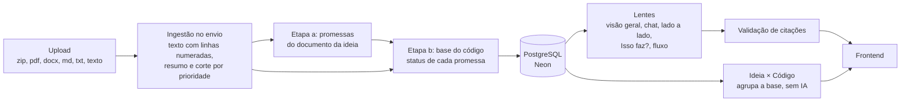
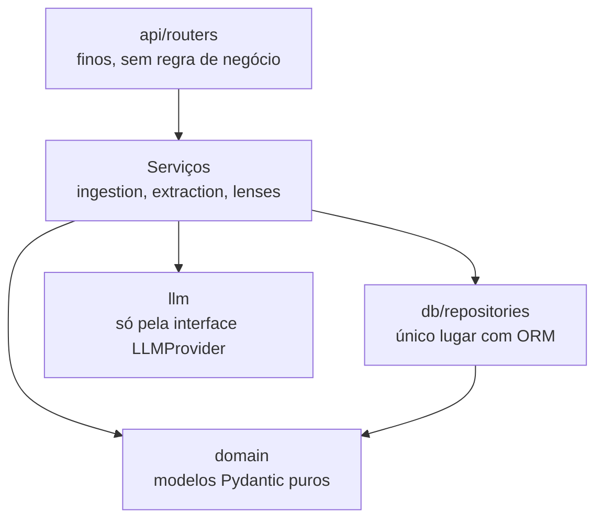

# Arquitetura

Visão de como o Fornalytics é organizado. As regras completas estão na seção 8 do `CLAUDE.md`; aqui fica o mapa.

## Pipeline do produto

## Camadas do backend

- Dependências sempre de cima para baixo; `domain/` não importa nada do projeto.
- Serviços recebem dependências pelo construtor (injeção via `api/deps.py`).
- Erros esperados são `AppError` (`core/errors.py`), convertidos em HTTP num handler único.
- Só `core/config.py` lê variáveis de ambiente.

## Frontend

- `app/`: rotas e providers (TanStack Query).
- `pages/`: telas, só compõem features.
- `features/<nome>/`: uma pasta por funcionalidade, sem importar outra feature.
- `shared/`: cliente da API, componentes genéricos e utilitários.
- Em desenvolvimento, o Vite encaminha `/api` para `localhost:8000` (sem CORS).

## O que já existe

| Parte | Status | Fase |
|---|---|---|
| `create_app()`, configurações, erros, logging | ✅ | 0 |
| `GET /api/health` (API, banco e IA) | ✅ | 0, 1 e 2 |
| Frontend com rotas, TanStack Query e Tailwind | ✅ | 0 |
| Banco: sessão assíncrona, 8 tabelas, migração inicial, status no health | ✅ | 1 |
| Provedores de IA (Gemini, Ollama, Fake) com novas tentativas | ✅ | 2 |
| Ingestão | ⏳ | 3 |
| Base do produto e citações | ⏳ | 4 |
| Lentes (visão geral e chat) | ⏳ | 5 |
| Telas do MVP | ⏳ | 6 |
| Lado a lado e "Isso faz?" | ⏳ | 7 |
| Ideia × Código (agrupa a base por status) | ⏳ | 8 |
| Fluxo (JSON → Mermaid montado no backend) | ⏳ | 9 |
