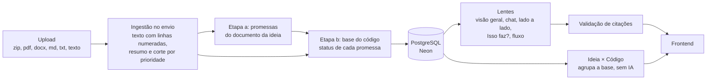
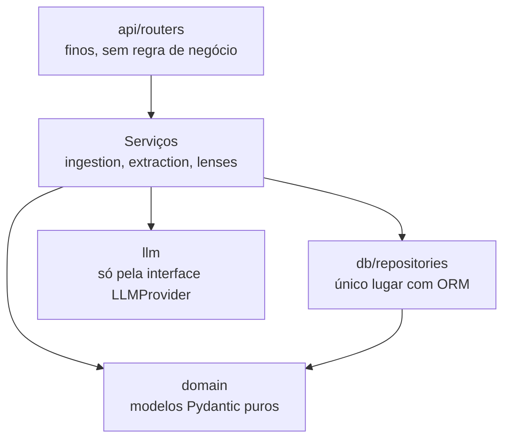
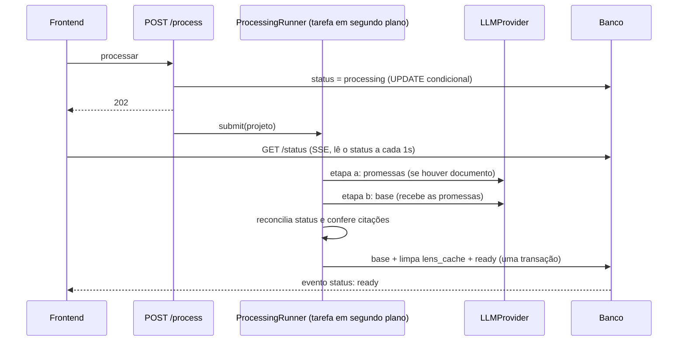

# Arquitetura

Visão de como o Fornalytics é organizado. As regras completas estão na seção 8 do `CLAUDE.md`; aqui fica o mapa.

## Pipeline do produto

## Camadas do backend

- Dependências sempre de cima para baixo; `domain/` não importa nada do projeto.
- Serviços recebem dependências pelo construtor (injeção via `api/deps.py`).
- Erros esperados são `AppError` (`core/errors.py`), convertidos em HTTP num handler único.
- Só `core/config.py` lê variáveis de ambiente.

## Processamento da base (Fase 4)

- `extraction/extractor.py` fala com a IA e não toca o banco; `extraction/reconcile.py` é puro; `extraction/service.py` grava; `extraction/runner.py` cuida da tarefa e dos erros.
- Material só de código ou só de documento usa **uma** chamada; ideia + código usa duas.

## Lentes (Fase 5)

- `lenses/context.py` (puro) monta o que vai ao modelo:
  - visão geral: só a base;
  - chat: base, arquivos relevantes (palavras da pergunta no caminho e no conteúdo, mais os arquivos citados nas evidências ligadas à pergunta) e as últimas `CHAT_HISTORY_TURNS` trocas.
- `lenses/overview.py` e `lenses/chat.py` têm duas partes:
  - `prepare` faz as checagens que viram HTTP comum (404, 409);
  - `answer` emite eventos de domínio (`TextDelta`, `CitationsChecked`...), que o router converte em SSE (`api/sse.py`).
- O trabalho durante o stream usa sessões curtas (`SessionFactory`), como o processamento em segundo plano.
- `citations/markers.py` acha e confere os marcadores `[[caminho:Lx-Ly]]` ao fim de cada resposta.

## Frontend

- `app/`: rotas e providers (TanStack Query).
- `pages/`: telas, só compõem features.
- `features/<nome>/`: uma pasta por funcionalidade, sem importar outra feature.
- `shared/`: cliente da API, componentes genéricos e utilitários.
- Em desenvolvimento, o Vite encaminha `/api` para `localhost:8000` (sem CORS).

## O que já existe

| Parte | Status | Fase |
|---|---|---|
| `create_app()`, configurações, erros, logging | ✅ | 0 |
| `GET /api/health` (API, banco e IA) | ✅ | 0, 1 e 2 |
| Frontend com rotas, TanStack Query e Tailwind | ✅ | 0 |
| Banco: sessão assíncrona, 8 tabelas, migração inicial, status no health | ✅ | 1 |
| Provedores de IA (Gemini, Ollama, Fake) com novas tentativas | ✅ | 2 |
| Projetos (criar, listar, detalhar) e ingestão no envio: extratores, filtros, limites, corte por prioridade | ✅ | 3 |
| Base do produto: extração em duas etapas, reconciliação, validação de citações, processamento em segundo plano e status por SSE | ✅ | 4 |
| Lentes: visão geral por lente (cache) e chat com streaming, contexto selecionado e citações por marcador | ✅ | 5 |
| Telas do MVP | ⏳ | 6 |
| Lado a lado e "Isso faz?" | ⏳ | 7 |
| Ideia × Código (agrupa a base por status) | ⏳ | 8 |
| Fluxo (JSON → Mermaid montado no backend) | ⏳ | 9 |
