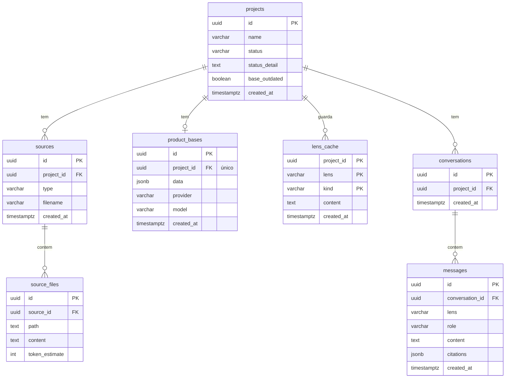

# Modelo de dados

PostgreSQL no Neon, acessado com SQLAlchemy 2 assíncrono + psycopg 3. Migrações com Alembic.
Código: `backend/app/db/models/` (tabelas) e `backend/app/domain/enums.py` (valores fixos).

> **Mudança planejada (início da Fase 3, [ADR 0002](adr/0002-ideia-x-codigo-derivado-da-base.md)):** a tabela `comparisons` será removida (o Ideia × Código passa a sair da base) e `projects` ganha `base_outdated`. O diagrama e as tabelas abaixo já mostram o esquema de destino; até a migração, o banco ainda tem `comparisons`.

## Diagrama



## Tabelas

| Tabela | Para quê | Observações |
|---|---|---|
| `projects` | Um produto analisado | `status` acompanha o processamento (Fase 4); `base_outdated` indica que as fontes mudaram depois da última base |
| `sources` | Cada arquivo enviado ou texto colado | `filename` vazio para texto colado |
| `source_files` | Texto extraído de cada arquivo (um zip gera vários) | Único por `source_id` + `path`; o arquivo original não é guardado |
| `product_bases` | A base do produto em JSON | **Uma por projeto**: reprocessar substitui. O Ideia × Código sai daqui (`features[].status`) |
| `lens_cache` | Saídas em cache por lente (hoje só a visão geral) | Chave: projeto + lente + tipo |
| `conversations` / `messages` | Histórico do chat | `citations` guarda as citações já validadas |

## Valores aceitos

Guardados como texto, com uma regra (`CHECK`) no banco que recusa qualquer outro valor.

| Campo | Valores |
|---|---|
| `projects.status` | `draft`, `processing`, `ready`, `failed` |
| `sources.type` | `code`, `idea_doc`, `transcript`, `text` |
| `lens_cache.lens`, `messages.lens` | `cliente`, `nao_tecnico`, `tecnico` |
| `lens_cache.kind` | `overview` |
| `messages.role` | `user`, `assistant` |

## Regras

- **Ids** são UUID gerados pela aplicação.
- **Datas** com fuso horário, preenchidas pelo banco (`now()`).
- **Apagar um projeto apaga tudo que pertence a ele** (`ON DELETE CASCADE` em todas as chaves estrangeiras).
- **Reprocessar um projeto** apaga o `lens_cache` dele e zera `base_outdated` na mesma transação que grava a nova base (Fase 4).
- **Adicionar ou remover uma fonte** de um projeto que já tem base marca `base_outdated = true`; a base anterior continua valendo até o reprocessamento.
- O formato dos campos `jsonb` é definido pelos modelos Pydantic de `app/domain/` (Fase 4 em diante).

## Conexões

| Variável | Uso |
|---|---|
| `DATABASE_URL` | Conexão **pooled** (endereço com `-pooler`), usada pela aplicação |
| `DATABASE_URL_DIRECT` | Conexão direta, usada pelo Alembic |
| `TEST_DATABASE_URL` | Branch `test` do Neon, usado só pelos testes de integração |

As URLs podem ser coladas como o Neon entrega (`postgresql://...`); o código escolhe o driver sozinho.
A conexão pooled não aceita *prepared statements*, por isso o engine usa `prepare_threshold=None`.

## Como mudar o esquema

1. Altere ou crie o model em `backend/app/db/models/` (e registre-o em `models/__init__.py`).
2. Gere a migração:
   ```bash
   npm run migration:new -- -m "descricao curta em ingles"
   ```
3. **Revise** o arquivo gerado em `backend/alembic/versions/` antes de aplicar.
4. Aplique:
   ```bash
   npm run migrate
   ```
5. Atualize esta página no mesmo commit.

Nunca altere tabelas manualmente no painel do Neon.
