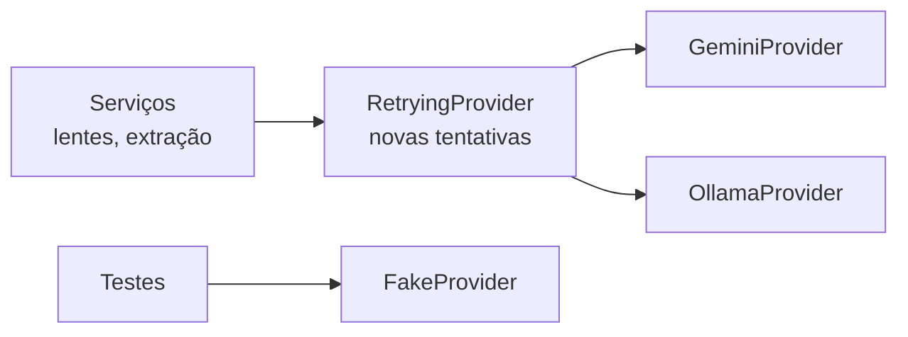

# IA em execução

Como o Fornalytics fala com modelos de IA. Código em `backend/app/llm/`.

## Visão geral



- Todo o sistema depende só da interface `LLMProvider` (`base.py`). Ninguém fora de `llm/` importa SDK de modelo.
- `factory.py` escolhe o provedor pelo `LLM_PROVIDER` e o envolve no `RetryingProvider`.
- Para acrescentar um provedor (ex.: Claude): criar `claude.py` implementando `LLMProvider`, traduzir os erros do SDK para os erros de `errors.py` e acrescentar um `case` em `factory.py`. Nada mais muda.

| Método | Devolve | Uso previsto |
|---|---|---|
| `generate(system, messages)` | Texto completo | Visão geral |
| `stream(system, messages)` | Texto em pedaços | Chat |
| `generate_json(system, messages, schema)` | Objeto Pydantic validado | Base do produto, "Isso faz?", Ideia × Código |

## Configurar o Gemini (principal)

1. Crie uma chave em https://aistudio.google.com/apikey (conta Google, sem cartão).
2. No `.env`: `LLM_PROVIDER=gemini` e `GEMINI_API_KEY=<sua chave>`.
3. Liste os modelos disponíveis para a sua chave:
   ```bash
   npm run llm:models
   ```
4. Coloque um modelo **Flash** em `GEMINI_MODEL` e confira:
   ```bash
   npm run llm:check
   ```
   Cada execução faz **uma** chamada real (gasta cota).

**Modelo em uso:** `gemini-3.5-flash` (escolhido em 06/11/2026). O `gemini-3.8-flash`, mais novo, devolveu 503 "alta demanda" seguidos nos testes. Se o 3.5 ficar instável, teste outro Flash com `GEMINI_MODEL=<modelo> npm run llm:check` antes de trocar no `.env`.

### Limites do plano gratuito

Os limites (requisições por minuto, por dia e tokens por minuto) mudam com frequência e variam por modelo. Consulte a tabela atual no AI Studio, na página de limites de uso (*rate limits*). Por isso o projeto:

- extrai a base do produto **uma vez** por projeto (2 chamadas: promessas da ideia e base do código) e salva no banco;
- gera cada visão geral só na primeira abertura da lente e guarda em cache;
- monta o Ideia × Código a partir da base, sem chamar a IA;
- responde o lado a lado com **uma** chamada para as 3 lentes;
- no chat, manda só as últimas `CHAT_HISTORY_TURNS` trocas;
- no chat, manda a base + poucos arquivos (`CHAT_MAX_FILES`, `CHAT_CONTEXT_TOKENS`);
- não chama a IA no `/api/health`.

### Privacidade

No plano gratuito, o Google pode usar o conteúdo enviado para melhorar os modelos. **Use apenas o repositório de demo ou projetos open source.**

## Novas tentativas

Implementadas em `retry.py` (`RetryingProvider`):

| Situação | O que acontece |
|---|---|
| 429 (cota) ou 5xx (alta demanda/instável) | Tenta de novo: espera ~2s, depois ~4s (com variação aleatória). Máximo de 3 tentativas no total |
| O servidor informa quanto esperar | Respeita o tempo informado |
| Espera informada maior que 30s | Não espera: devolve na hora o aviso com o tempo |
| Erro no streaming **depois** do primeiro pedaço | Não tenta de novo (duplicaria texto na tela) |
| JSON fora do formato | Não tenta de novo (o Gemini garante o formato; repetir gastaria cota) |

As novas tentativas do próprio SDK do Gemini ficam **desligadas**, para não multiplicar chamadas.

## Erros mostrados ao usuário

| Erro | HTTP | Quando |
|---|---|---|
| `QuotaExceeded` | 429 | Cota gratuita atingida mesmo após as novas tentativas |
| `ProviderUnavailable` | 503 | Alta demanda persistente, rede fora ou Ollama desligado |
| `ProviderNotConfigured` | 503 | Falta chave/modelo, chave recusada ou modelo inexistente |
| `InvalidModelOutput` | 502 | Resposta fora do formato pedido |

Mensagens em português, sem dados sensíveis. Os logs registram só o código e o tipo do erro, nunca a chave.

## Ollama (reserva local)

Use quando estiver sem internet ou sem cota. Troca **manual**, sem fallback automático.

1. Instale em https://ollama.com e baixe um modelo, por exemplo:
   ```bash
   ollama pull llama3.2
   ```
2. No `.env`: `LLM_PROVIDER=ollama` e `OLLAMA_MODEL=llama3.2`.
3. Confira com `npm run llm:check`.

Limitações: modelos locais pequenos erram JSON estruturado com mais frequência e aceitam menos contexto. Funcionam para chat e visão geral; a **extração da base (de onde sai o Ideia × Código) e o lado a lado devem ser feitos com o Gemini**.

## Testes

Todos com `FakeProvider` ou respostas simuladas (`httpx.MockTransport`), sem rede e sem cota: `backend/tests/unit/llm/`.
